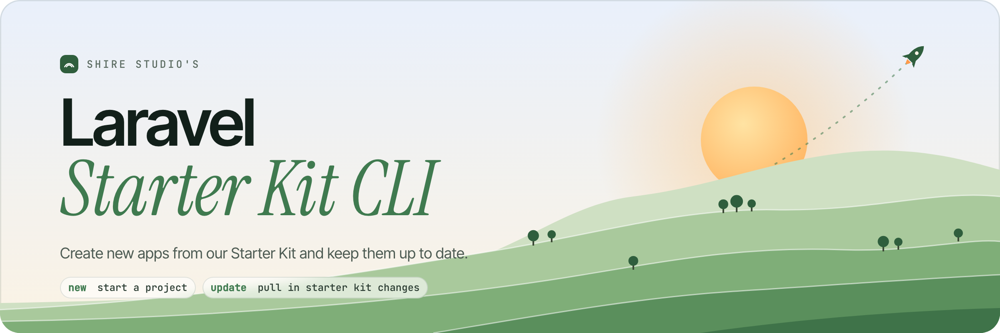

<picture>
    <source media="(prefers-color-scheme: dark)" srcset="art/header-dark.png">
    
</picture>

<br/>
<br/>

<p>
    <a href="https://github.com/shire-studio/laravel-starter-kit-cli/actions"></a>
    <a href="https://packagist.org/packages/shire-studio/laravel-starter-kit-cli"></a>
    <a href="LICENSE.md"></a>
</p>

The installer for the Shire Studio Laravel starter kits. Use `new` to start a project from a starter kit, `update` to bring newer starter kit changes into a project you've already built with one, and `teams` to add teams to a project created without them. Think of it as the `laravel` installer, but for our starter kits.

## The Kits

| Kit | Stack | Package |
| --- | --- | --- |
| `vue` | Inertia, Vue 3 and shadcn-vue | [shire-studio/laravel-starter-kit-vue](https://github.com/shire-studio/laravel-starter-kit-vue) |
| `react` | Inertia, React 19 and shadcn/ui | [shire-studio/laravel-starter-kit-react](https://github.com/shire-studio/laravel-starter-kit-react) |
| `svelte` | Inertia, Svelte 5 and shadcn-svelte | [shire-studio/laravel-starter-kit-svelte](https://github.com/shire-studio/laravel-starter-kit-svelte) |
| `livewire` | Livewire 4 and Flux | [shire-studio/laravel-starter-kit-livewire](https://github.com/shire-studio/laravel-starter-kit-livewire) |
| `api` | Sanctum tokens and JSON resources | [shire-studio/laravel-starter-kit-api](https://github.com/shire-studio/laravel-starter-kit-api) |
| `blade` | Blade views and Tailwind CSS | [shire-studio/laravel-starter-kit-blade](https://github.com/shire-studio/laravel-starter-kit-blade) |

## Requirements

- [PHP 8.5+](https://php.net/releases/)
- [Composer](https://getcomposer.org)
- [git](https://git-scm.com)
- [pnpm](https://pnpm.io), if you want `new` to install and build the frontend
- A supported coding agent, if you want `update` to apply the changes for you (see below)

## Installation

Install the CLI globally with Composer:

```bash
composer global require shire-studio/laravel-starter-kit-cli
```

This installs the `shire-kit` command. Make sure Composer's global bin directory is on your `PATH` (run `composer global config bin-dir --absolute` to find it), then check it works:

```bash
shire-kit --version
```

To upgrade to the latest release later, run `composer global update shire-studio/laravel-starter-kit-cli`.

## Usage

### Create a new project

```bash
shire-kit new example-app --kit=react
```

This creates `example-app` from the latest stable release of the React starter kit. Without `--kit` you'll be asked which kit to use. You'll also be asked whether to add teams (not for the Blade kit, which has no teams), whether to install the frontend dependencies and build the assets (not for the API kit, which has no frontend), and whether to initialise a git repository. Skip the questions with these options:

| Option | What it does |
| --- | --- |
| `--kit=<kit>` | Use `vue`, `react`, `svelte`, `livewire`, `api` or `blade`. Required with `--no-interaction` |
| `--teams` / `--no-teams` | Add teams to the project, or don't |
| `--pnpm` / `--no-pnpm` | Install the frontend dependencies and build the assets, or don't |
| `--git` / `--no-git` | Initialise a git repository with a first commit, or don't |
| `--force`, `-f` | Overwrite the project directory if it already exists |

Every new project gets a `.starter-kit.json` file recording the kit and release it was created from, and whether it has teams. Commit it, because `update` reads it to work out which changes the project hasn't received yet.

#### Teams

Teams follow the teams flow of Laravel's official starter kits: a personal team for every user, team switching, members with roles, and invitations. Every kit except Blade has them. They don't ship as a separate kit. Each kit release carries them as an overlay in `.starter-kit/teams/`, and `new` applies it when you ask for teams. Without teams, `new` removes the overlay, so you get the same project as a plain `composer create-project`.

To deal with the overlay before Composer installs anything or runs any scripts, `new` runs `composer create-project` with `--no-install` and `--no-scripts`. Once the overlay is applied or removed, it runs the project's `post-root-package-install` scripts, then `composer install` (which runs the install and autoload scripts itself), then the `post-create-project-cmd` scripts. That is the same order a plain `composer create-project` runs them in.

If a kit release has no teams overlay (for example a release from before teams were added), `new --teams` stops with an error instead of giving you a project without teams.

### Update an existing project

Run `update` from the root of a project created from the starter kit:

```bash
cd example-app
shire-kit update
```

The project has to be in a git repository and have no uncommitted changes, so everything the update does can be reviewed with `git diff` and undone with `git restore`. It can sit inside a larger repository, such as a monorepo. Only changes inside the project directory count.

The CLI reads the kit from `.starter-kit.json`, works out what changed between the project's release and the latest release of that kit, then hands those changes to a coding agent of your choice to apply. The agent does the judgement work: merging upstream changes into files you've customised, keeping your own changes, and fixing anything the update breaks. These agents are supported, and only the ones you have installed are offered:

- [Claude Code](https://claude.com/claude-code) (`claude`)
- [Codex](https://github.com/openai/codex) (`codex`)
- [Gemini CLI](https://github.com/google-gemini/gemini-cli) (`gemini`)
- [OpenCode](https://opencode.ai) (`opencode`)
- [Cursor](https://cursor.com/cli) (`cursor-agent`)

An update runs in these steps:

1. You choose an agent, or pass one with `--agent`.
2. The CLI downloads both starter kit releases and writes the changes between them to `.starter-kit-update/` in the project. It holds the diff, the old and new version of every changed file, the upstream commit messages (when they can be fetched) and a prompt for the agent. The directory is excluded from git.
3. The agent starts in an interactive session with the prompt. Follow along, answer its questions, and exit the session when it's done.
4. The CLI shows the changed files. If the agent found features you removed on purpose, you pick which ones to record (see below). Then the CLI asks whether to mark the project as updated. If you say yes, it updates `.starter-kit.json` and removes `.starter-kit-update/`.

If you say no, the project keeps its current version in `.starter-kit.json`, and `.starter-kit-update/` stays in place with the agent's changes still in your working tree. To finish by hand, copy `.starter-kit-update/.starter-kit.json` (which already includes the removed features you picked) to `.starter-kit.json`, then delete `.starter-kit-update/`. The end of `.starter-kit-update/PROMPT.md` lists the same steps. Running `update` (or `teams`) again stops while `.starter-kit-update/` holds changes that were never marked as done, so they aren't lost by accident. Finish them by hand as above, or delete `.starter-kit-update/` to start over. An update started again from scratch also needs `--force`, because the agent's changes are still uncommitted.

For a project with teams, both releases are compared with their teams overlay applied, so the changes include the team code and your team files don't show up as local changes. A project whose `.starter-kit.json` has no `teams` entry counts as a project without teams. The overlay directory itself is never part of an update.

If the newer release has nothing to apply to the project (for example, only its lock files changed), the CLI marks the project as updated straight away, without an agent. This also happens with `--agent=none` and `--no-interaction`.

Nothing is committed. Review the changes, then commit them yourself.

| Option | What it does |
| --- | --- |
| `--agent=<agent>` | Skip the question and use `claude`, `codex`, `gemini`, `opencode`, `cursor` or `none` |
| `--kit=<kit>` | The kit a project without `.starter-kit.json` was created from |
| `--force`, `-f` | Run even if the project has uncommitted changes |

With `--agent=none`, or with `--no-interaction` and no `--agent`, the CLI only prepares `.starter-kit-update/` (unless there is nothing to apply, as described above). Follow `.starter-kit-update/PROMPT.md` yourself, or hand it to any coding agent you like. The prompt ends with the steps to mark the project as updated.

#### Removed features stay removed

If you removed a starter kit feature from your project, such as authentication, the update won't bring it back. The CLI lists every starter kit file the project no longer has, and the agent is told never to restore them, to skip changes that only touch removed code, and to ask you when it isn't sure. When the agent finds features you removed on purpose, it suggests notes about them. The CLI asks which ones to keep and saves them in `.starter-kit.json`, so future updates remember them.

#### Projects without `.starter-kit.json`

Starter kit releases published with its release workflow ship `.starter-kit.json` themselves, so even projects created with a plain `composer create-project` have one. For an older project without it, the CLI first needs the kit. Pass it with `--kit`, or pick it when asked (the kit named in the project's `composer.json` is preselected). The agent then works out which release of that kit the project started from. You confirm the version, the CLI records it in `.starter-kit.json`, and the update carries on as normal. This needs an agent, so with `--agent=none` or `--no-interaction` the update fails until you add `.starter-kit.json` by hand.

`.starter-kit.json` has to name one of the kit packages above and a stable release of it. Projects created from the original `shire-studio/laravel-starter-kit` package need their `package` changed to `shire-studio/laravel-starter-kit-vue` first. If it records a pre-release or a branch, `update` stops instead of guessing what changed.

### Add teams to an existing project

Run `teams` from the root of a project created from the starter kit without teams:

```bash
cd example-app
shire-kit teams
```

Like `update`, it needs a git repository with no uncommitted changes and a `.starter-kit.json` (run `update` first if the project has none). It adds the teams variant of the release the project was created from, not of the latest release. If that release has no teams overlay, run `update` first.

1. The CLI downloads the release twice and applies the teams overlay to one copy, so it knows exactly what teams change.
2. It applies every change that doesn't touch your own work: files teams add, files you haven't changed, and files you have changed where Git can merge the teams change into your version without a conflict. Files teams delete are removed only if you haven't changed them.
3. Whatever is left is a file you changed in a way that conflicts with teams, a file you removed, or a file of your own where teams add one. These go to `.starter-kit-update/` with a prompt, and a coding agent of your choice merges them, as in `update`. Your files are never overwritten with conflict markers.
4. Once nothing is left, or once you confirm after the agent session, `.starter-kit.json` records `"teams": true`.

The team migrations only add tables and columns, and a data migration gives every existing user a personal team. Run `php artisan migrate` yourself once you've reviewed the changes. The CLI never touches your database. Teams need login and registration, so if a removed feature recorded in `.starter-kit.json` mentions login, registration or authentication, `teams` warns you and asks before carrying on. Without interaction, it stops. It also stops if `.starter-kit-update/` still holds changes from an earlier `update` or `teams` run that were never marked as done, so they aren't lost.

| Option | What it does |
| --- | --- |
| `--agent=<agent>` | Skip the question and use `claude`, `codex`, `gemini`, `opencode`, `cursor` or `none` |
| `--force`, `-f` | Run even if the project has uncommitted changes |

## Local Development

> **Requires [PHP 8.5+](https://php.net/releases/), [Composer](https://getcomposer.org), and a code coverage driver like [Xdebug](https://xdebug.org/docs/install) or [PCOV](https://github.com/krakjoe/pcov).**

```bash
git clone git@github.com:shire-studio/laravel-starter-kit-cli.git
cd laravel-starter-kit-cli
composer install
composer test
```

### Available Commands

- `composer lint`: fix code style with Rector and Pint
- `composer test:lint`: check code style without changing anything
- `composer test:types`: PHPStan (Larastan, level max)
- `composer test:type-coverage`: 100% type coverage
- `composer test:unit`: Pest in parallel, 100% code coverage
- `composer test`: all of the above

The unit suite also runs Pest's `php`, `strict` and `security` arch presets.

CI runs `composer test` on PHP 8.5 for every push and pull request to `main`. Dependabot handles GitHub Actions and Composer updates.

### Vetting Dependencies

[laravel/vet](https://github.com/laravel/vet) checks every installed package against the hashes in `vet.json`, and holds back anything released in the last 2 days (`minimum-release-age`).

When you add, remove or update a package, run vet and commit the updated `vet.json` with your lock file:

```bash
vendor/bin/vet
```

**Note:** `brianium/paratest` is held below 7.26.1 by a `conflict` entry in `composer.json`. Its new `WrapperWorker` constructor breaks parallel runs on Pest 5.3.1. Drop the conflict once Pest fixes it.

### Building the PHAR

```bash
php shire-kit app:build
```

The PHAR ends up in `builds/shire-kit`. You'll be asked for a version unless you pass `--build-version`. What goes into it is set in `box.json`. Packages in `require-dev` are left out, so build from a `composer install --no-dev` checkout to match a release.

## Releasing

Releases are published by the **release** workflow, not from the Releases page. In the Actions tab, run it on `main` with the new version, for example `v1.5.0`.

The workflow builds the PHAR, then commits it on top of `main` together with a trimmed `composer.json` that requires only PHP and points `bin` at `builds/shire-kit`. It tags that commit and publishes a GitHub release with generated notes and the PHAR attached. The release commit is only reachable from its tag, so `main` keeps its full `composer.json` and never has a `builds` directory.

Installing a release therefore pulls in no other packages. That matters for `composer global require`, where every global tool shares one set of dependencies. Without the PHAR, an older global tool that pins an older Laravel version (such as Valet 3) would block the install.

The workflow refuses versions that already exist or aren't newer than the latest release.

## Contributing

1. Branch off `main` (`feat/my-feature` or `fix/my-fix`)
2. Make your changes
3. Run `composer lint`, then `composer test`
4. Write commits as [Conventional Commits](https://www.conventionalcommits.org), e.g. `feat: add update command`
5. Open a pull request against `main`

## License

This project was created by **Shire Studio** under the **[MIT license](LICENSE.md)**.
