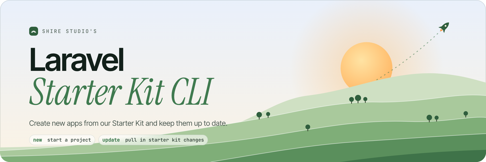

<picture>
    <source media="(prefers-color-scheme: dark)" srcset="art/header-dark.png">
    
</picture>

<br/>
<br/>

<p>
    <a href="https://github.com/shire-studio/laravel-starter-kit-cli/actions"></a>
    <a href="https://packagist.org/packages/shire-studio/laravel-starter-kit-cli"></a>
    <a href="https://packagist.org/packages/shire-studio/laravel-starter-kit-cli"></a>
</p>

The installer for the [Shire Studio Laravel starter kit](https://github.com/shire-studio/laravel-starter-kit). Use `new` to start a project from the starter kit, and `update` to bring newer starter kit changes into a project you've already built with it. Think of it as the `laravel` installer, but for our starter kit.

> Work in progress. Neither command is ready yet.

## Requirements

- [PHP 8.5+](https://php.net/releases/)
- [Composer](https://getcomposer.org)
- [git](https://git-scm.com)

## Installation

Coming with the first release.

## Usage

### Create a new project

`new` is being built now. Docs will follow once it's merged.

### Update an existing project

`update` is next. Run it inside a project created from the starter kit to pull in newer starter kit changes.

## Local Development

> **Requires [PHP 8.5+](https://php.net/releases/), [Composer](https://getcomposer.org), and a code coverage driver like [Xdebug](https://xdebug.org/docs/install) or [PCOV](https://github.com/krakjoe/pcov).**

```bash
git clone git@github.com:shire-studio/laravel-starter-kit-cli.git
cd laravel-starter-kit-cli
composer install
composer test
```

### Available Commands

- `composer lint`: fix code style with Rector and Pint
- `composer test:lint`: check code style without changing anything
- `composer test:types`: PHPStan (Larastan, level max)
- `composer test:type-coverage`: 100% type coverage
- `composer test:unit`: Pest in parallel, 100% code coverage
- `composer test`: all of the above

The unit suite also runs Pest's `php`, `strict` and `security` arch presets.

CI runs `composer test` on PHP 8.5 for every push and pull request to `main`. Dependabot handles GitHub Actions and Composer updates.

### Vetting Dependencies

[laravel/vet](https://github.com/laravel/vet) checks every installed package against the hashes in `vet.json`, and holds back anything released in the last 2 days (`minimum-release-age`).

When you add, remove or update a package, run vet and commit the updated `vet.json` with your lock file:

```bash
vendor/bin/vet
```

**Note:** `brianium/paratest` is held below 7.26.1 by a `conflict` entry in `composer.json`. Its new `WrapperWorker` constructor breaks parallel runs on Pest 5.3.1. Drop the conflict once Pest fixes it.

### Building the PHAR

```bash
php application app:build
```

The PHAR ends up in `builds/application`. You'll be asked for a version unless you pass `--build-version`. What goes into it is set in `box.json`.

## Contributing

1. Branch off `main` (`feat/my-feature` or `fix/my-fix`)
2. Make your changes
3. Run `composer lint`, then `composer test`
4. Write commits as [Conventional Commits](https://www.conventionalcommits.org), e.g. `feat: add update command`
5. Open a pull request against `main`

## License

Released under the [MIT license](https://opensource.org/licenses/MIT).
